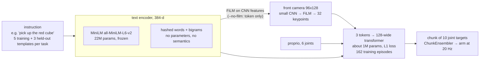

# so-arm100-vla

A small language-conditioned multitask policy for the
[SO-ARM100](https://github.com/TheRobotStudio/SO-ARM100) tabletop tasks,
trained from scratch on scripted demonstrations, evaluated on instructions
and (task, colour) pairs it never saw. CPU only. Built on
[`so-arm100-sim`](https://github.com/AungKaung1928/so-arm100-sim), which
defines the tasks, the expert, the success criteria and the instruction
templates this repository holds out.

**Walkthrough:** https://aungkaung1928.github.io/projects/so-arm100.html — the bench and the three policy projects built on it, explained end to end.

## At a glance

Success rate per split, nominal physics, 20 episodes × 5 evaluation seeds per (task, colour) cell, mean ± sd over seeds, one training seed per row. Measured 2026-09-24.

| policy | `seen` (training templates, training pairs) | `paraphrase` (held-out templates) | `combo` (held-out pairs) |
|---|---|---|---|
| `LangPolicy`, MiniLM encoder, FiLM | 0.110 ± 0.081 | 0.097 ± 0.060 | 0.027 ± 0.046 |
| `LangPolicy`, hashed bag-of-words encoder | 0.092 ± 0.046 | 0.073 ± 0.057 | 0.027 ± 0.021 |
| `LangPolicy`, MiniLM, no FiLM | 0.137 ± 0.075 | 0.110 ± 0.056 | 0.033 ± 0.038 |
| SmolVLA-base, zero-shot, inference only | 0 of 40 episodes (10 per task); 3.16 s per action chunk on CPU | not run | not run |
| scripted expert (bench, development readings) | 1.0 reach, 0.8–0.9 push, ≥ 0.9 lift / pick_place | n/a | n/a |



### Results

| method | metric | value | condition |
|---|---|---|---|
| `LangPolicy`, MiniLM | success, `seen` | 0.110 ± 0.081 | per task: reach 0.25, push 0.04, lift 0.07, pick_place 0.01 |
| `LangPolicy`, MiniLM | success, `paraphrase` | 0.097 ± 0.060 | reach 0.24, push 0.03, lift 0.03, pick_place 0.03 |
| `LangPolicy`, MiniLM | success, `combo` | 0.027 ± 0.046 | held-out pairs `lift:blue`, `push:red`, `pick_place:green` |
| `LangPolicy`, MiniLM | final-epoch L1, training / held-out episodes | 0.057 / 0.128 | 162 training episodes, about 20 per (task, colour) pair |
| encoder ablation | success spread across the three rows | every row inside the others' spread | base policy at 3–14%, no headroom |
| MiniLM cosine, "lift the green cube" vs | paraphrase / other task / other colour | 0.38–0.59 / **0.63** / 0.82 | "hoist the green block", "push the red cube to the target", "lift the blue cube" |
| SmolVLA-base, zero-shot | success | 0.00 / 0.00 / 0.00 / 0.00 | 10 episodes per task, 0 of 40 |
| SmolVLA-base | 50-step chunk inference p50 | 3.16 s (p90 3.30 s, n = 130) | 8 CPU threads; 64x the 50 ms control period |
| LoRA gate, SmolVLM-256M LM shape | s/step, batch 1, seq 256, 8 threads | **0.51 s, best of 2 → GO** | rule fixed beforehand: GO under 5 s/step; 176.7M stand-in, 0.55M trainable (0.31%) |
| evaluation | wall per policy | about 1.7 h | 20 × 5; the written protocol of 100 × 5 would have been over 8 h |
| Docker image | tests inside | 21 passed, 2 skipped | 3.13 GB, built 2026-09-23 |

### Key points

- **The policy barely works, and the data is why.** Seen 0.110, paraphrase 0.097, combo 0.027, with reach at about a quarter and push, lift and pick_place at 0–7%; the final-epoch L1 is 0.128 on held-out demonstration episodes against 0.057 on training ones from 162 episodes, so it fits what it saw before language even enters, and the next experiment is more demonstrations per pair.
- **The encoder ablation has no power.** MiniLM 0.110 / 0.097 / 0.027, hashed 0.092 / 0.073 / 0.027 and no-FiLM 0.137 / 0.110 / 0.033 are each inside the others' spread, so the ordering is noise at this success level and the test only becomes informative once the base policy is fixed.
- **MiniLM is driven by surface words, not by the colour.** "lift the green cube" sits 0.63 from "push the red cube to the target" and 0.82 from "lift the blue cube", but only 0.38 from its own paraphrase "hoist the green block", which is why `paraphrase` is hard and `combo` asks the policy to read colour out of two nearly parallel vectors.
- **SmolVLA-base zero-shot scores 0 of 40 and costs 3.16 s per chunk.** One 50-step action chunk on 8 CPU threads is 64x the 50 ms control period, so a 450M-parameter VLA is not a real-time controller on CPU whatever its success after fine-tuning; the line is a calibration against a different embodiment, not evidence about SmolVLA.
- **The LoRA gate passed at 0.51 s/step but no fine-tune was run.** 2,000 steps would be about 0.3 h, yet the gate timed the language-model half only (no vision tower, no flow-matching head), every policy here is one training seed, and the protocol was cut from 100 to 20 episodes per seed to fit 1.7 h per evaluation.

<details><summary><b>What this is, and what it is not</b></summary>

**Status: measured 2026-09-24.** The trained policy is weak (11% on seen
instructions, 3% on held-out combinations) and the encoder ablation is
inside its own noise. Every number in this README is produced by the named command
and copied from its JSON in `runs/`, never typed in.

It **is**: a 128-wide transformer over three tokens (a frozen sentence
embedding, 32 image keypoints from a small CNN, the arm's proprioception)
that emits chunks of ten joint targets, trained with an L1 loss on a few
thousand frames of expert demonstrations for four tasks and three colours.
The instruction decides which cube and which task; all three cubes are
always on the table.

It is **not** a vision-language-action foundation model, and it does **not**
fine-tune one. SmolVLA-base appears below as a zero-shot reference run
through the same protocol, inference only. A LoRA fine-tune of a
SmolVLM-sized network is gated on a measured compute check and is not
attempted unless the gate passes -- and even then it is future work, not a
result here.

Why build the small version at all: the interesting property of a VLA is
that one policy follows language across tasks and objects and generalises
to phrasings and combinations it was not trained on. That property can be
tested at 1M parameters on a laptop CPU with a real held-out protocol. What
cannot be tested here is scale, and this repository does not pretend to.

</details>

<details><summary><b>The three splits and the measured result</b></summary>

Sentences and (task, colour) combinations come from the bench's
`instructions` module, so "unseen" means the same thing here, in the
imitation project, and in the recorder that never writes the held-out side.

| split | templates | (task, colour) pairs | what success on it shows |
|---|---|---|---|
| `seen` | training | training (9 of 12) | the policy executes what it was shown |
| `paraphrase` | **held out** | training | the instruction is read through the encoder, not matched as a string |
| `combo` | training | **held out** (3 of 12) | colour and task compose; every task and every colour was seen, never together |

Held-out pairs: `lift:blue`, `push:red`, `pick_place:green`. Five training
and three held-out templates per task, e.g. training "pick up the {c} cube",
held-out "hoist the {c} block".

### Results, 20 episodes x 5 seeds per (task, colour) cell, nominal physics

`python eval_language.py --ckpt runs/policy_minilm_s0.pt --episodes 20 --seeds 5 --jobs 8`

The protocol was written as 100 episodes per seed. At about 1.7 hours per
policy for 20 on this CPU, 100 would have been over eight hours per policy
and 25 for the ablation, so every policy here ran 20 x 5; the spread over
seeds below is what that costs.

| split | success | +- over seeds | reach | push | lift | pick_place |
|---|---|---|---|---|---|---|
| seen | 0.110 | 0.081 | 0.25 | 0.04 | 0.07 | 0.01 |
| paraphrase | 0.097 | 0.060 | 0.24 | 0.03 | 0.03 | 0.03 |
| combo | 0.027 | 0.046 | — | 0.03 | 0.03 | 0.02 |

**What this says: the policy barely works.** Reach succeeds about a
quarter of the time; push, lift and pick-place sit between 0 and 7%, which
is close to the floor (`eval_floor.py`, a policy that holds its start pose, same
protocol: 0 of 1,200 episodes; `runs/eval_floor_hold.json`), so every success counted
here is the policy's. This is the measured result, not a placeholder. The
training record says why: the final-epoch L1 on held-out demonstration
episodes is 0.128 against 0.057 on the training ones (`runs/policy_minilm_s0.json`),
from 162 training episodes, about 20 per (task, colour) pair. The policy
fits the demonstrations it saw and does not generalise from them, before
language even enters. The next experiment is more demonstrations per pair,
not a different encoder.

Does it read the colour at all? `probe_language.py` re-scores demonstration frames with the
policy's own masked L1 after swapping the colour word for another cube's, or the sentence for
another task on the same colour (no simulator, one thread, about 20 s per policy). With the
recorded sentences it reproduces each training log's final val L1.

| policy | val L1, recorded | wrong colour | wrong task | train L1, recorded | wrong colour | wrong task |
|---|---|---|---|---|---|---|
| MiniLM, FiLM | 0.1275 | 0.1286 | 0.1419 | 0.0572 | 0.0681 | 0.1112 |
| hashed bag-of-words | 0.1279 | 0.1305 | 0.1479 | 0.0581 | 0.0675 | 0.1290 |
| MiniLM, no FiLM | 0.1306 | 0.1325 | 0.1542 | 0.0557 | 0.0645 | 0.1164 |

On the 18 held-out episodes the wrong colour costs 0.8-2.1 % and the wrong task 11-18 %; on the
162 training episodes the wrong colour costs 16-19 %. The policies use the colour word only on
episodes they memorised, which is the near-zero `combo` result seen from the inside. Offline
L1 is not success rate: the closed-loop wrong-instruction run is still to do.

Reference line: the scripted expert that produced the data succeeds at
roughly 0.9 or better on `lift` and `pick_place`, 0.8-0.9 on `push`, 1.0 on
`reach` in the bench's development readings; its measured table lives in
the bench repository. A learned policy is bounded by it.

</details>

<details><summary><b>The encoder ablation: does the language model matter?</b></summary>

Two encoders produce the same 384-d embedding shape:

- **MiniLM** (`all-MiniLM-L6-v2`, 22M parameters, frozen). A sentence model
  that puts "hoist the blue block" near "lift the blue cube".
- **Hashed bag of words + bigrams.** No parameters, no semantics. "hoist"
  and "lift" land in unrelated buckets.

If the hashed policy scores as well as MiniLM on `paraphrase`, the split was
not testing language understanding. If MiniLM wins there and ties on
`seen`, the difference is the encoder's contribution and nothing else,
because the policy, data and seeds are identical.

| encoder | seen | paraphrase | combo |
|---|---|---|---|
| MiniLM | 0.110 ± 0.081 | 0.097 ± 0.060 | 0.027 ± 0.046 |
| hashed | 0.092 ± 0.046 | 0.073 ± 0.057 | 0.027 ± 0.021 |
| MiniLM, no FiLM | 0.137 ± 0.075 | 0.110 ± 0.056 | 0.033 ± 0.038 |

Success rate, mean ± standard deviation over the 5 evaluation seeds, one
training seed per encoder (the protocol said three; one training run is
about four minutes, but each evaluation is 1.7 hours, and three would have
tripled that). `--no-film` removes the language modulation of the vision
features, leaving language as a token only.

**The ablation does not separate the encoders.** Every row is inside the
others' spread, and the ordering (no FiLM highest on `seen`) is noise at
this success level: with the base policy at 3-14%, there is no headroom for
the encoder to show a difference. The test is valid; the policy under it is
too weak for it to have power. It becomes informative once the base policy
is fixed by more data, and not before.

One measured fact about MiniLM on these templates, before any policy is
trained (cosine similarities, `test_text.py` records the behaviour rather
than asserting it away): "lift the green cube" is 0.59 from its paraphrase
"raise the green block into the air" and 0.38 from "hoist the green block",
but **0.63 from "push the red cube to the target"** and 0.82 from "lift the
blue cube". The encoder is driven by shared surface words; the colour word
moves the embedding very little. So the `paraphrase` split is hard for a
reason that sits in the encoder, and the `combo` split asks the policy to
read colour out of a small difference between two nearly parallel vectors.
Whether FiLM on the vision features is enough to do that is exactly what the
ablation measures.

</details>

<details><summary><b>SmolVLA-base zero-shot, and the LoRA gate</b></summary>

### SmolVLA-base, zero-shot, same simulator

`python smolvla_reference.py --run --episodes 10`

`lerobot/smolvla_base` was pretrained on community SO-100/101 data: real arms,
real cameras, motor units. Here it receives a rendered 96x128 frame
letterboxed to its 512x512 input, six joint angles in radians zero-padded to
its state width, and the instruction. Nothing is adapted, and the expected
result is low. This is a **calibration line**, not a comparison of
capability: it says what a well-known model does under this protocol with
no adaptation, next to a small policy that was trained for it.

| task | success (10 episodes each) | chunk inference p50, CPU |
|---|---|---|
| reach / push / lift / pick_place | 0.00 / 0.00 / 0.00 / 0.00 | 3.16 s (p90 3.30 s, n = 130) |

0 of 40 episodes, as expected. The line is still useful for two things: it
shows the observation mapping runs end to end against the real checkpoint,
and it prices the model on this machine. One 50-step action chunk costs
3.2 s on 8 CPU threads, which is 64x the 50 ms control period at 20 Hz;
even with chunking the arm would wait 3 s every 2.5 s of motion. On CPU a
450M-parameter VLA is not a real-time controller, whatever its success
rate after fine-tuning.

Caveats that make this a reference and not a result: different embodiment
normalisation statistics, different camera placement, radians against motor
units, 20 Hz control against 30 fps data, and one rendered view copied
into all three of its camera slots. `--dry-run` validates the
observation mapping against a stub with the same feature keys and runs in
the tests without the download.

### The LoRA gate

`OMP_NUM_THREADS=8 nice -n 10 python lora_gate.py`

Before proposing a fine-tune, measure whether one step of it is affordable.
The gate builds a decoder with SmolVLM-256M's language-model shape (hidden
576, 30 layers, 9 heads, MLP 1536), attaches rank-8 LoRA to the query and
value projections (a from-scratch `LoRALinear`, unit tested: identity at
init, exact merge/unmerge), and times one forward-backward-optimizer step at
batch 1, sequence 256, on 8 threads. **Rule, fixed before measuring: GO
under 5 s/step, else NO-GO.** At 5 s/step, 2,000 steps is 2.8 hours, which is
the most a chunked, attended CPU run here can carry.

Measured 2026-09-22 (`runs/lora_gate.json`): stand-in of 176.7M parameters,
0.55M trainable (0.31%), **0.51 s per step on 8 threads, best of 2 -> GO**.
2,000 steps would be about 0.3 h. The gate measures compute feasibility of
the language-model half only: the real SmolVLA action expert adds a vision
tower and a flow-matching head that were not timed, and a GO here says a
fine-tune is affordable to *try*, not that it would help. A NO-GO would have
dropped the fine-tune from the project; it did not lower the bar.

### Fine-tune on a Kaggle T4 (prepared, not run yet)

`kaggle/smolvla_finetune.ipynb` (generated by `kaggle/make_notebook.py`)
records 20 demonstrations per training pair in the smolvla_base layout
(`so_arm100_sim.record --smolvla`) and fine-tunes `lerobot/smolvla_base`
with `lerobot-train`, sizing the step count from a measured 20-step timing
run. Checked so far: the full path ran 2 steps on the laptop CPU (batch 2,
4 threads, 75-86 s/step, 100M of 450M parameters trainable), and
`eval_smolvla_ft.py`'s loader and runner ran one `reach:red:distractors` episode
on a 2-step checkpoint (2026-11-21: 100 steps, 2 chunk computes, 2.38 s p50 per
50-step chunk on CPU; success 0.00, expected after 2 steps).
`kaggle/preflight.py` reruns the notebook's record command (1 episode, 2 pairs),
parses its `lerobot-train` arguments with lerobot 0.6.1 and loads one batch, in
under a minute on one core; `kaggle/RUNBOOK.md` has the run steps and the result
check. Not checked: anything on the T4. Two caveats on the zero-shot line above: that run fed
radians and skipped LeRobot's normalizer, and the simulator's Pitch at home
(-90 deg) sits 4 standard deviations from the released SO-100 action stats.
A fine-tune replaces those stats with the dataset's own, so neither carries over.

</details>

<details><summary><b>Edge: SmolVLA-base in OpenVINO on a laptop CPU (FP32)</b></summary>

`edge/export_ov.py` exports `lerobot/smolvla_base` through Intel's `physicalai`
0.3.0 library (`SmolVLA(...).to_openvino`, FP32; venv pins in
`edge/requirements-edge.txt`, separate from the main requirements). 62 s, a
1.57 GB weights file plus an OpenVINO tokenizer. `edge/parity_time.py` feeds the
same preprocessed inputs (3 cameras at 512x512, 6-d state, 48 prompt tokens) to
PyTorch and to the compiled OpenVINO model, both on 4 threads. Measured
2026-11-21 on an Intel Core Ultra 5 225H in WSL2 (4 vCPUs visible), not a Jetson.
The raw output of the edge runs was not kept, so unlike the tables above no
`runs/*.json` backs this section and no test checks it; the commit that added each table
names its headline number (`git log -- edge/`).
`edge/combo_1cam.py` and `edge/fp32_interleaved.py` take an optional JSON path
as their third argument for the next run.

| | value |
|---|---|
| max \|PyTorch - OpenVINO\| over one 50 x 6 action chunk | 3.9e-6 (3 inputs; the chunks differ by up to 0.18 between inputs) |
| PyTorch FP32, one chunk (10 denoising steps), p50 / p99, n = 30 | 3,154 / 3,503 ms |
| OpenVINO FP32, same, n = 30 | 3,096 / 3,255 ms |
| OpenVINO INT8 weights (`edge/int8_ov.py`, `nncf.compress_weights` defaults, nncf 3.4.0), n = 30 | 1,295 / 1,476 ms |
| max \|PyTorch - OpenVINO INT8\| over one chunk, 3 inputs | 0.073-0.160 (mean 0.023-0.048) |

Those two FP32 rows ran one after the other and look equal; interleaved call by call
in one process (`edge/fp32_interleaved.py`, n = 20 each, same input) OpenVINO FP32 is
3,008 / 3,221 ms p50 / p99 against PyTorch's 3,770 / 4,046 ms, 20 % faster (parity
2.4e-6). INT8 weight compression goes further: weights 1.57 → 0.40 GB, p50 2.4x faster. But
its error against PyTorch (up to 0.16) is the same size as the difference between
two different inputs' chunks (0.13-0.19), so INT8 is not shown to be safe: that
needs closed-loop success on a fine-tuned checkpoint (smolvla_base itself scores 0.00
on all four tasks here, so its success cannot show a drop).

Fewer denoising steps, accuracy side (`edge/steps_tradeoff.py`, PyTorch FP32, 4 threads,
n = 10 per row, error against the default 10-step chunk on the same 3 inputs, whose
10-step chunks differ from each other by up to 0.26):

| `num_steps` | max / mean error vs 10 steps | p50 / p99 per chunk |
|---|---|---|
| 10 | 0 / 0 | 2,967 / 3,039 ms |
| 5 | 0.073 / 0.030 | 3,036 / 3,233 ms |
| 2 | 0.407 / 0.121 | 2,827 / 2,990 ms |
| 1 | 0.715 / 0.200 | 3,096 / 3,414 ms |

The times in that table come from separate model loads and are too noisy to compare.
`edge/steps_interleaved.py` switches one loaded model between 10 and 1 steps on
alternating calls (n = 10 each): 10 steps 3,196 ms p50 (2,524-3,400), 1 step 2,573 ms
(2,006-2,915), so dropping to one step saves about 0.6 s (19 %) at an error of 0.5 to
0.7. Most of the chunk is the shared prefix, which the steps do not touch.

Per stage (`edge/profile_stages.py`, wall time inside every `nn.Linear` call summed by
owner, n = 5 chunks; the hooks themselves raise the chunk to 3,444 ms p50):

| stage | ms per chunk | share |
|---|---|---|
| vision encoder (3 cameras, 512x512) | 1,521 | 48 % |
| action expert (all 10 steps) | 416 | 13 % |
| VLM text layers | 218 | 7 % |
| connector + other | 21 | 1 % |
| outside Linear calls (attention, norms, resize) | 987 | 31 % |

The vision encoder is the lever: fewer cameras or a smaller input size, not fewer
steps. The interleaved 0.6 s saving is the same order as the expert's 416 ms here
(the remainder is likely attention outside Linear calls; not measured).

Camera count and image size (`edge/cameras_tradeoff.py`, one loaded model, variants
interleaved, n = 8 each; 'change' = max difference from the 3-camera 512 px chunk):

| input | p50 (min-max) per chunk | change |
|---|---|---|
| 3 cameras, 512 px | 3,020 ms (2,568-3,084) | 0 |
| 2 cameras, 512 px | 2,208 ms (1,883-2,511) | 0.47 |
| 1 camera, 512 px | 1,360 ms (1,187-1,405) | 0.63 |
| 3 cameras, 256 px | 1,107 ms (975-1,215) | 0.92 |

Time scales with pixels: about 0.83 s per 512 px camera, so one camera or 256 px
images both fit the 2.5 s chunk in FP32. The change column is not an error: the
pretrained model was trained at 512 px and sees different input, so either option
needs a fine-tune on that input before its success can be judged (the export's
preprocessor resizes to 512 px by default, so 256 px also means changing it).

Combined, 1 camera at 512 px (`edge/combo_1cam.py`: OpenVINO re-exported with a
1-camera input, since its shapes are fixed at export; the three backends interleaved
in one process, n = 20 each, same input):

| backend, 1 camera | p50 / p99 per chunk | max \|out - PyTorch\| |
|---|---|---|
| PyTorch FP32 | 1,848 / 2,039 ms | 0 |
| OpenVINO FP32 | 1,398 / 1,656 ms | 2.1e-6 |
| OpenVINO INT8 weights | 733 / 937 ms | 0.093 |

Interleaved, OpenVINO FP32 is 24 % faster than PyTorch here (20 % at 3 cameras). The same PyTorch 1-camera input took 1,360 ms p50 in the
camera run and 1,848 ms here: absolute times move between processes by about that
much, so compare within one table only. INT8 weights at 1 camera use 29 % (p50) to 37 % (p99) of the
2.5 s chunk, the only setup here with real margin, still with the accuracy
question open. Values are in the normalized action space, before the
postprocessor. One chunk covers 50 control steps = 2.5 s at the simulator's
20 Hz (`so_arm100_sim.env.CONTROL_HZ`), so a 3.1 s chunk is 1.24x too slow for
real time on this CPU: the arm would stall between chunks. INT8 weights at 1.3 s
would fit (0.52 of the chunk), if the accuracy holds.

<details><summary><b>What is in the box</b></summary>

```
so_arm100_vla/
  text.py        MiniLMEncoder (cached to disk) and HashEncoder, both 384-d
  splits.py      seen / paraphrase / combo, from the bench's instruction tables
  data.py        recording via the bench expert; flat cache; k-step action windows
  model.py       LangPolicy (CNN -> FiLM -> keypoints; 3 tokens; k queries), ChunkEnsembler
  policy.py      LangRunner: carries the sentence the bench env does not know about
  lora.py        LoRALinear, attach_lora
record_data.py   every training combination, distractors on, successes only
train.py         final-epoch reporting, checkpoint carries stats + encoder name
eval_language.py the three splits through the bench protocol, JSON + table
smolvla_reference.py, lora_gate.py
tests/           encoders, splits, windowing, shapes, ensembling, LoRA math,
                 SmolVLA mapping, and an end-to-end record -> train -> eval smoke
```

Model size at the default configuration: printed by `train.py`
(`LangPolicy N params`), about 1M.

</details>

## Reproducing

```
python3 -m venv .venv && . .venv/bin/activate          # Python >= 3.12
pip install torch==2.11.0 torchvision==0.26.0 --index-url https://download.pytorch.org/whl/cpu
pip install -r requirements.txt && pip install -e .
./verify.sh                                            # tests, then the commands below
python record_data.py --root data/multitask --episodes 20
nice -n 10 python train.py --root data/multitask --encoder minilm --epochs 30
python eval_language.py --ckpt runs/policy_minilm_s0.pt
```

Recording renders every frame in software (about 20 ms at 96x128), so 20
episodes per combination is roughly ten minutes. Training is CPU-only,
under `nice`, chunked by epochs; the log warns when throughput drops more
than 20% from the first epochs, which on a laptop is either throttling or
another process, and the load average says which.

```
docker build -t so-arm100-vla . && docker run --rm so-arm100-vla   # offline tests
```

Image built on 2026-09-23 and its default command passed inside it (21 tests passed, 2 skipped, the one that downloads a text encoder deselected), image size 3.13 GB.

<details><summary><b>Limits, stated</b></summary>

- Simulation only, fixed front camera, three cubes of three colours.
- Language is templated. Negation, relations and counting are outside the
  set (see `docs/ISSUES.md`).
- The expert is scripted; the policy inherits its style and its failure
  modes.
- The SmolVLA line is zero-shot from a different embodiment and is not
  evidence about SmolVLA.
- Nothing here has run on a physical arm.

</details>

## Licence

MIT. The bench and its vendored Menagerie model carry their own licences.
