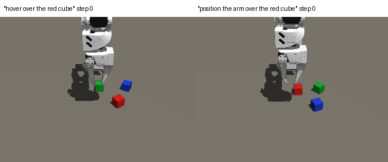
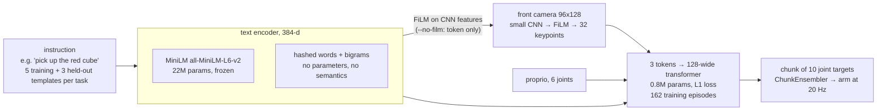

# so-arm100-vla

Language-conditioned multitask policy for simulated SO-ARM100 tabletop tasks, trained from scratch on scripted demonstrations and tested on instructions and (task, colour) pairs it never saw. The policy step runs in 0.35-0.44 ms p50 through the ONNX Runtime C++ API (one thread), and a ROS 2 node wraps it (tested in CI).



The hash-encoder policy on `reach:red`, real time: one episode it solves, one it does not. It solved 4 of 8 such episodes (`runs/act_closed_loop.json`); rebuild with `scripts/make_demo.py`.

Success rate per split, nominal physics, 20 episodes × 5 evaluation seeds per (task, colour) cell, mean ± sd over seeds, one training seed per row. Measured 2026-09-24.

| policy | `seen` (training templates, training pairs) | `paraphrase` (held-out templates) | `combo` (held-out pairs) |
|---|---|---|---|
| `LangPolicy`, MiniLM encoder, FiLM | 0.110 ± 0.081 | 0.097 ± 0.060 | 0.027 ± 0.046 |
| `LangPolicy`, hashed bag-of-words encoder | 0.092 ± 0.046 | 0.073 ± 0.057 | 0.027 ± 0.021 |
| `LangPolicy`, MiniLM, no FiLM | 0.137 ± 0.075 | 0.110 ± 0.056 | 0.033 ± 0.038 |
| SmolVLA-base, zero-shot, inference only | 0 of 40 episodes (10 per task); 3.16 s per action chunk on CPU | not run | not run |
| scripted expert (bench, development readings) | 1.0 reach, 0.8–0.9 push, ≥ 0.9 lift / pick_place | n/a | n/a |



Success rates are low: 0.8M parameters trained on 162 episodes. That is the baseline the SmolVLA fine-tune ([`kaggle/RUNBOOK.md`](kaggle/RUNBOOK.md), prepared, not run yet) has to beat.

## Quick start

Linux, Python ≥ 3.12, CPU only. The simulator ([so-arm100-sim](https://github.com/AungKaung1928/so-arm100-sim)) installs as a pinned dependency.

```bash
git clone <this repo URL>
cd so-arm100-vla
python3 -m venv .venv && . .venv/bin/activate                                  # first time only
pip install torch==2.11.0 torchvision==0.26.0 --index-url https://download.pytorch.org/whl/cpu   # first time only
pip install -r requirements.txt && pip install -e .                            # first time only
./verify.sh   # tests, then reruns the cheap checks against runs/*.json ("match"); about 6 min on a laptop CPU
              # it also prints the record / train / eval commands
```

Recording 20 episodes per (task, colour) takes about 12 minutes on one core (2 per combination took 71 s, 2026-11-23); one evaluation of 20 × 5 episodes per cell takes about 1.7 h with `--jobs 8` (8 processes; far longer on one). Full commands, Docker and the C++ / ROS 2 builds: [docs/RESULTS.md](docs/RESULTS.md#reproducing).

## Limits

Simulation only, fixed front camera, three cubes of three colours, templated language, scripted expert. The SmolVLA row is zero-shot from a different embodiment and says nothing about SmolVLA itself. Nothing here has run on a physical arm.

## License

MIT. The bench and its vendored Menagerie model carry their own licences.
